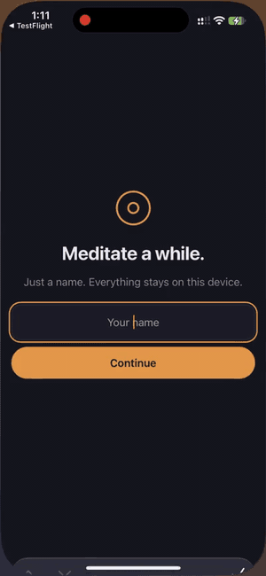
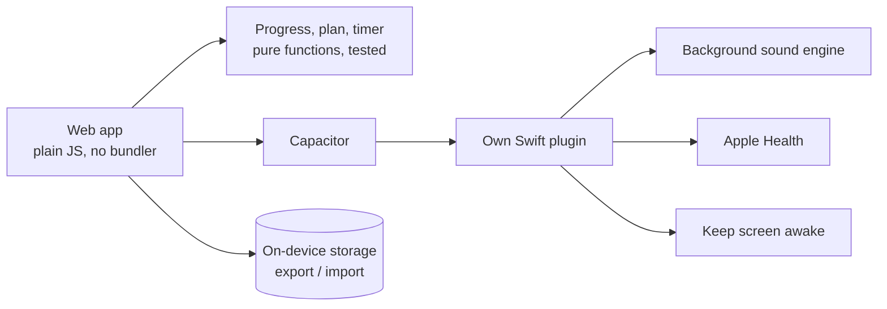

# Gentle Meditation Timer

**A meditation timer for busy people where a missed day never costs you your progress.**

> Built autumn 2026 · Live on the [App Store](https://apps.apple.com/app/id6823328743) · Source private

*First run on an iPhone. Pick a length, settle in, meditate, save, and see what you earned.*

**Full demo (35 seconds)** covers the first run, a meditation, settings and Apple Health, and the progress screen.

https://github.com/user-attachments/assets/484e22de-9df4-490b-b0b9-85d9e413f25b

## Purpose

**Hypothesis:** a meditation app built for focus retention and awareness keeps people practising if it's simple, sets a research-based target, and lets the streak fit their real week.

Most streak apps reset you to zero after one missed day. That works for people who never miss and loses everyone else.

Four principles shape the design:

- **Simple.** Pick 3, 5 or 10 minutes and start. The first session is guided.
- **Based on research.** Amishi Jha, who studies attention at the University of Miami, recommends about [12 minutes a day, five days a week](https://www.mindful.org/find-your-focus-own-your-attention-in-12-minutes-a-day/), so 12 minutes is the default goal.
- **Grows on its own.** "Grow my practice" adds a minute after every three days of practice, up to 12. Missed days don't reset the count.
- **Fits your week.** You choose how many days a week make a good week, and how many rest days the streak allows. One missed day a month can be repaired. Levels and badges never go down.

## What it does

1. Pick a length and begin. The app counts you in, rings the bells and plays ambient sound, even with the phone locked.
2. End when you're ready. If it's going well, the clock keeps counting after the bell and saves the extra time.
3. The meditation is saved with its XP and can go to Apple Health as mindful minutes.

## Architecture

The approach, in four decisions:

- **No streak freezes for sale.** Selling protection from a lost streak makes money from anxiety, so it was ruled out from the start.
- **One web app, with native code only where iOS needs it.** The app is the same web code inside a native shell. A small Swift plugin handles what a web page can't do on an iPhone: bells on time with the screen locked, Apple Health, and keeping the screen awake.
- **The rules live in pure, tested functions.** Progress, the growth plan and the timer have no UI code, so they're covered by 43 unit tests plus browser checks, and could move to Swift unchanged.
- **Nothing leaves the phone.** You sign in with a name only, and data stays on the device with export as the backup. The App Store privacy label is "Data Not Collected".

| Part | Choice |
|---|---|
| App | HTML, CSS and JavaScript (ES modules) |
| iOS shell | Capacitor 8, plus a custom Swift plugin |
| Platform features | Background audio, HealthKit, local notifications, haptics |
| Tests | Node test runner (43 unit tests), browser checks |

## Outcome

Live on the App Store since November 2026. Too early for usage numbers, so none are claimed.

| Metric | What it tests | Result |
|---|---|---|
| Users who meditate again within a week of missing a day | Whether forgiving progress brings people back | Pending |
| 30-day retention | Whether forgiving progress keeps the habit going | Pending |
| People on "Grow my practice" who reach 12 minutes | Whether starting small and growing reaches the research-backed target | Pending |
| Users who report better focus after 4 weeks | Whether the practice improves focus retention and awareness | Pending |

## What I learned

- **Design the reward for the person you want back.** A streak that resets pulls hardest, but it pulls through fear. I kept asking what the app should do the day after someone misses. In this app, they come back to everything they'd earned.
- **Use the web until the platform says no.** Bells that ring on time with a locked screen, and Apple Health, needed native code. Everything else didn't. Keeping the logic in tested web code meant the Swift plugin compiled first time and the app shipped in three weeks.
- **What you write into someone's health record must be exact.** The first version logged Health time from the moment you pressed Begin, warm-up included. Now it logs from the end of the warm-up to the real end, and discarding a meditation removes its Health entry too.

---

More about me at [shrikantvarma.com](https://shrikantvarma.com).
