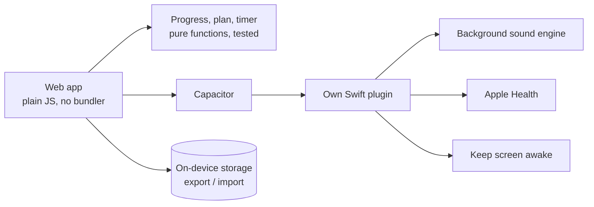

# Gentle Meditation Timer

**A meditation timer for busy people where a missed day never costs you your progress.**

> Built autumn 2026 · Live on the [App Store](https://apps.apple.com/app/id6823328743) · Source private

*First run on an iPhone: pick a length, settle in, meditate, save, and see what you earned.*

**Full demo (35 seconds):** first run → settle in → meditate → save → settings and Apple Health → progress.

https://github.com/user-attachments/assets/484e22de-9df4-490b-b0b9-85d9e413f25b

## Purpose

**Hypothesis:** meditation habits break after one bad day, because streak apps turn a missed day back into zero. Progress that forgives keeps people coming back.

Most habit apps pull you back through fear of losing a streak. That works on people who never miss and punishes exactly the person you most want back: the one who just did.

## What it does

1. **You** type a name and pick 3, 5 or 10 minutes. The first one is guided.
2. **The app** counts you in, rings the bells and plays ambient sound, even with the phone locked.
3. **You** end when you're ready. If it's going well, the clock keeps counting after the bell and saves the extra time.
4. **The app** records the meditation, awards XP, and can save it to Apple Health as mindful minutes.
5. **Optionally**, "Grow my practice" adds a minute after every three completed days, up to 12 minutes.

## Architecture

The approach, in five decisions:

- **Progress never punishes a missed day.** XP and levels only go up. The daily streak allows rest days, and one repair a month can fill a gap. Badges are kept forever. The only thing that lowers progress is the user deleting a meditation.
- **No streak freezes for sale.** Selling protection from a lost streak makes money from anxiety, so it was ruled out from the start.
- **One web app, native only where iOS says no.** The app is the same web code inside a native shell. A small Swift plugin handles what a web page can't do on an iPhone: bells on time with the screen locked, Apple Health, and keeping the screen awake.
- **The rules live in pure, tested functions.** Progress, the growth plan and the timer have no UI code, so they're covered by 43 unit tests plus browser checks, and could move to Swift unchanged.
- **Nothing leaves the phone.** You sign in with a name only, and data stays on the device with export as the backup. The App Store privacy label is "Data Not Collected".

| Part | Choice |
|---|---|
| App | HTML, CSS and JavaScript (ES modules) |
| iOS shell | Capacitor 8, plus a custom Swift plugin |
| Platform features | Background audio, HealthKit, local notifications, haptics |
| Tests | Node test runner (43 unit tests), browser checks |

## Outcome

Live on the App Store since November 2026. Too early for usage numbers, so none are claimed.

| Metric | What it tests | Result |
|---|---|---|
| Users who meditate again within a week of missing a day | The core hypothesis | Pending |
| 30-day retention | Whether forgiving progress keeps the habit going | Pending |
| Meditations that use "Grow my practice" to step up | Whether gradual growth works | Pending |

## What I learned

- **Design the reward for the person you want back.** A streak that resets is the strongest pull, but it pulls through fear. The question that settled it: what does the app do on the day after someone misses? Here, it welcomes them back with everything they'd earned.
- **Use the web until the platform says no.** Bells that ring on time with a locked screen, and Apple Health, needed native code. Everything else didn't. Keeping the logic in tested web code meant the Swift plugin compiled first time and the app shipped in three weeks.
- **What you write into someone's health record must be exact.** The first version logged Health time from the moment you pressed Begin, warm-up included. Now it logs from the end of the warm-up to the real end, and discarding a meditation removes its Health entry too.

---

More about me at [shrikantvarma.com](https://shrikantvarma.com).
